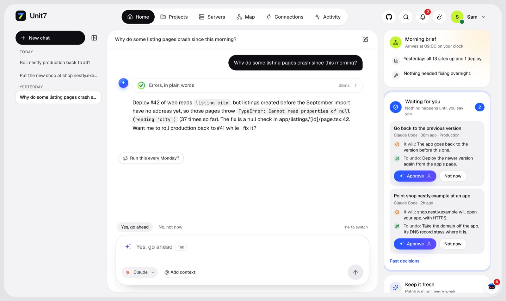
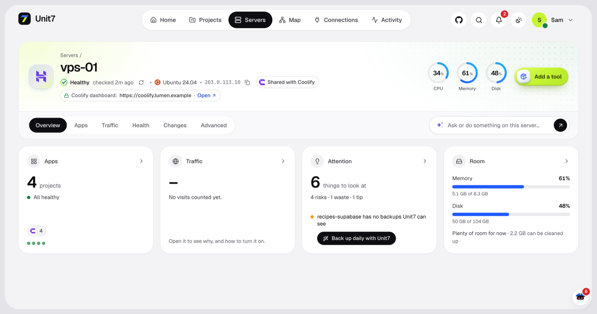
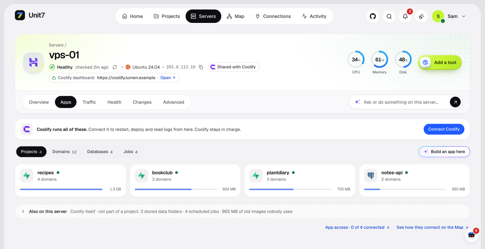
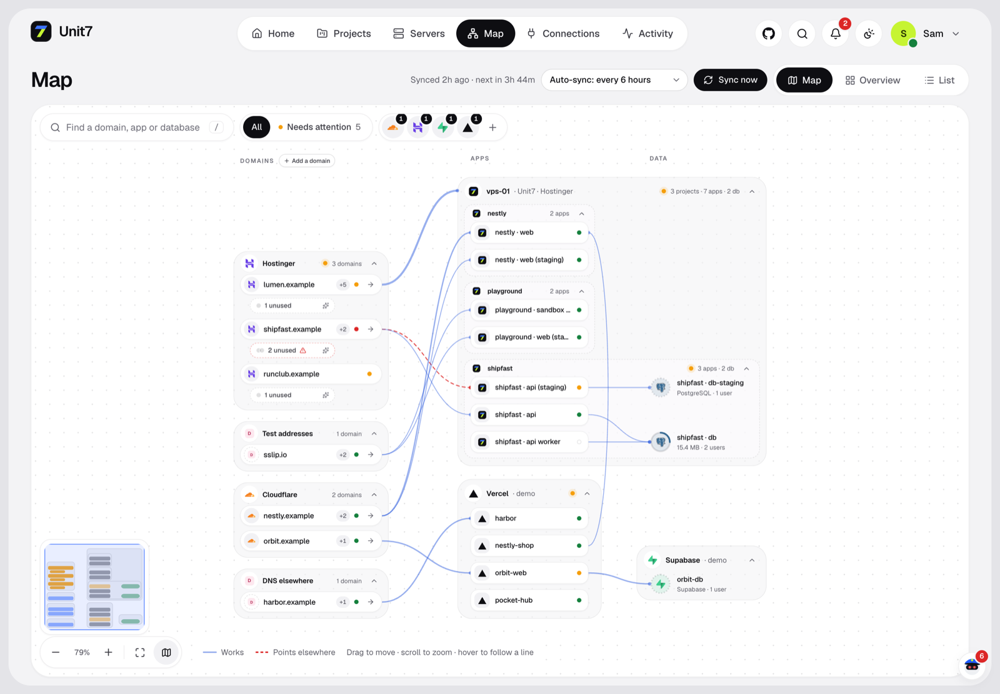
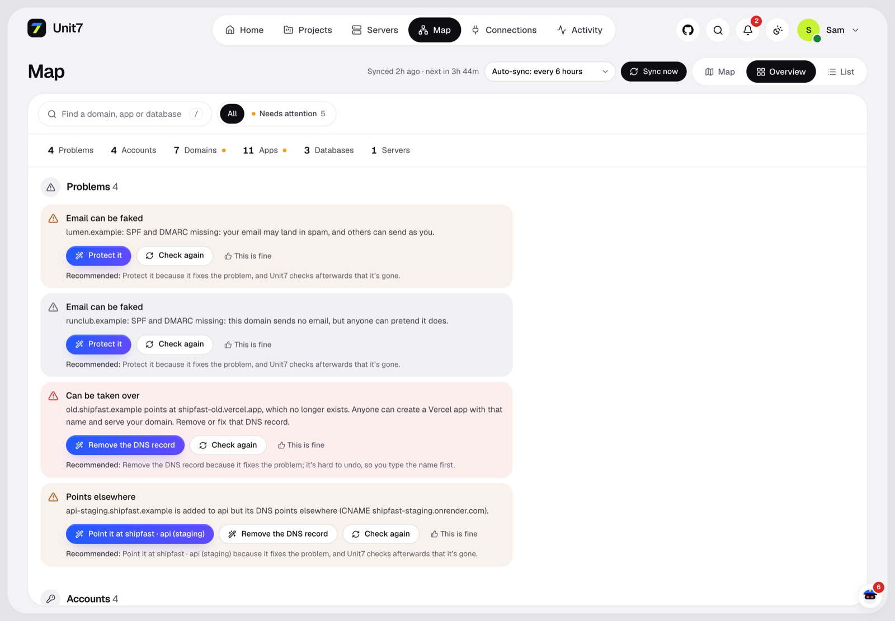
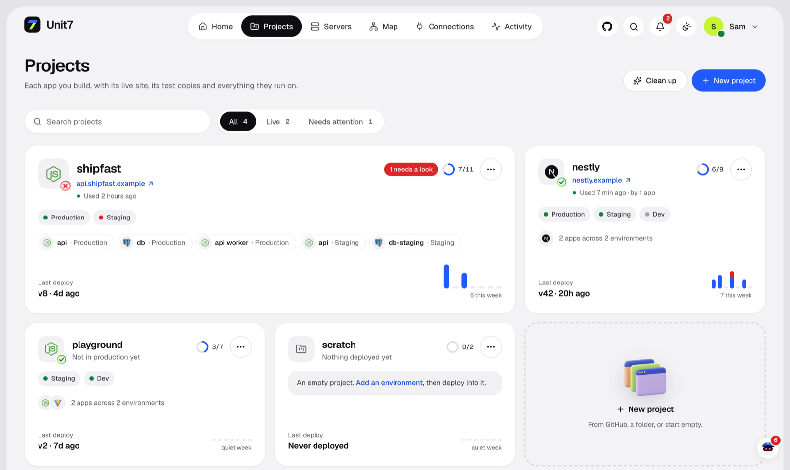
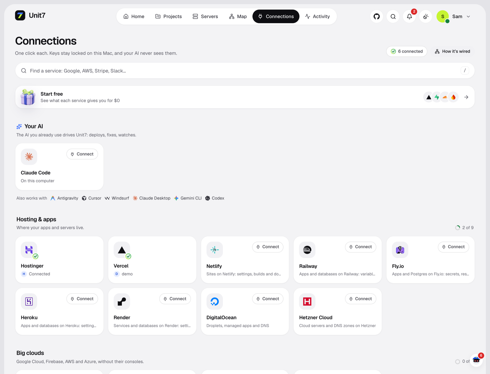
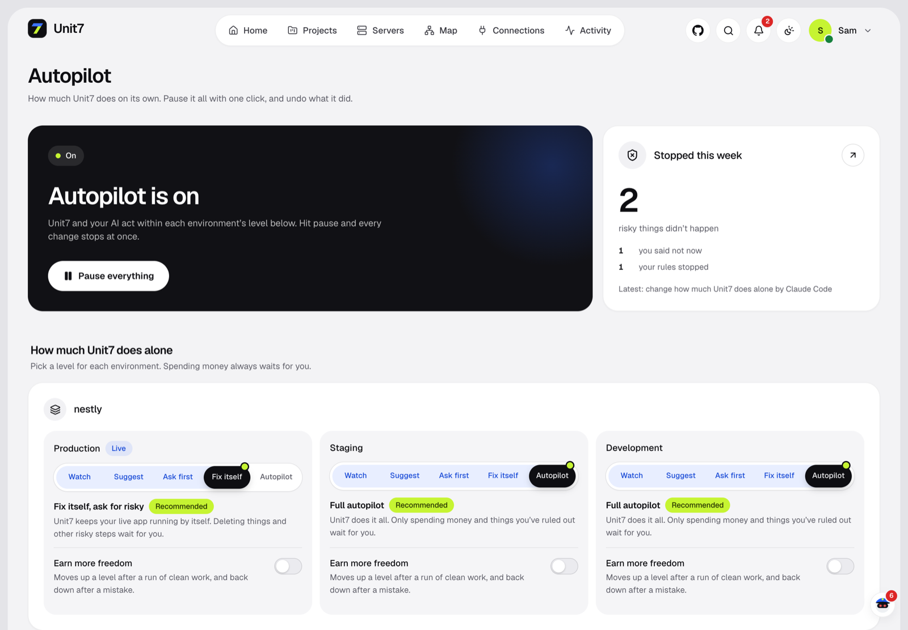
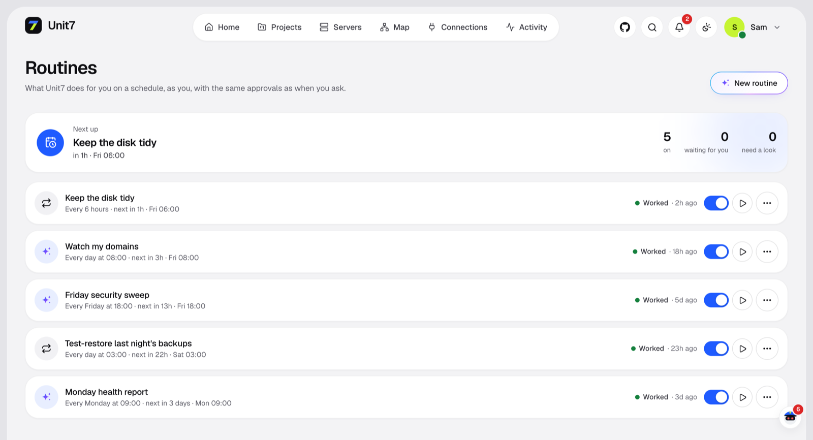
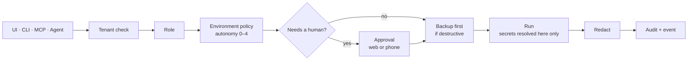

<div align="center">


# Unit7

### The backend developer your AI coding agent never had.

Self-hosted control room for your servers, Coolify apps, domains, databases and backups.<br>
Talk to it in plain words. It does the work, and asks before anything risky.

<br>

[](https://github.com/Nandkishorrr/unit7/stargazers)
[](https://github.com/Nandkishorrr/unit7/network/members)
[](https://github.com/Nandkishorrr/unit7/issues)
[](https://github.com/Nandkishorrr/unit7/commits/main)
<br>
[](LICENSE)


[](https://github.com/Nandkishorrr/unit7/pulls)

<br>

[**Quick start**](#-quick-start) · [**Screenshots**](#-screenshots) · [**Features**](#-features) · [**How it stays safe**](#-how-it-stays-safe) · [**Support**](#-support-unit7)

<br>



<br>

<a href="https://buymeacoffee.com/nandkishorrr"></a>

</div>

---

## ✨ Why Unit7

AI agents write the code in minutes. Everything after that still eats your evenings: the VPS, the Coolify
stacks, DNS spread over three providers, backups you *hope* work, the port you forgot was open.

Unit7 is a self-hosted, autonomous infrastructure operating system for people who build with AI and don't want
to become a DevOps engineer. You tell it what you want — *"deploy this", "add Postgres",
"point app.example.com at production", "why is prod slow?"* — and it operates your real servers.

**One Node process plus one SQLite file.** It runs on your laptop or a small VPS and manages your other servers over
SSH. A web command center, a CLI and an MCP server all drive the same engine, so the UI, your terminal and your AI
coding agent (Claude Code, Cursor, Antigravity, Codex…) can do exactly the same things through exactly the same
safety gate.

<div align="center">

| 🧰 **400+** tools (or a small profile) | 🧪 **900+** tests, many on real SSH + Docker | 🔌 **20+** providers | 📦 **1** process, **1** SQLite file |
|:---:|:---:|:---:|:---:|

</div>

### Works with

<p>
&nbsp;&nbsp;&nbsp;&nbsp;&nbsp;&nbsp;&nbsp;&nbsp;&nbsp;&nbsp;&nbsp;&nbsp;&nbsp;&nbsp;&nbsp;&nbsp;&nbsp;&nbsp;&nbsp;&nbsp;&nbsp;&nbsp;&nbsp;&nbsp;&nbsp;&nbsp;&nbsp;&nbsp;&nbsp;&nbsp;&nbsp;&nbsp;&nbsp;&nbsp;
</p>

## 🧭 Is everything OK?

One button, or `unit7 checkup`. No AI needed, free, and it only reads. You get four answers: is there room, is your data safe, is anything open, and is your app behaving. Each thing to do says who fixes it: Unit7, your AI, or only you.

- **Safety Net.** Important data with no safe copy gets one by itself, sent off the server and proven by a test restore. Automatic steps only ever create or copy.
- **Give this to my AI.** A finding becomes a prompt for Cursor, Claude Code or Codex. After your next deploy, Unit7 reads the same numbers and says Fixed or Still happening.
- **Call Inspector.** Polling, duplicate calls, one page making 40 calls, retry storms, from your proxy log, with nothing to install.
- **Outpost.** One small script on the server, so it's still watched while your Mac sleeps. No open port.
- **What can a stranger do?** Your own sites from outside. It counts rows and reads none.

Unit7 runs on your computer. **When your Mac sleeps, nobody is watching**, unless you add an Outpost. The Always on page shows the hours it missed. See [LIMITS.md](LIMITS.md), [TRUST.md](TRUST.md) and [ACCIDENTS.md](ACCIDENTS.md).

## 🚀 Quick start

### The easy way: let Claude Code set it up

Open [Claude Code](https://claude.com/claude-code) in any folder, paste this, and it does the rest:

```text
Set up Unit7 for me from https://github.com/Nandkishorrr/unit7

1. Check that Node.js 24.15 or newer is installed. If not, install it (nvm, or Homebrew on macOS).
2. Clone the repo into ~/unit7, then run `npm install` and `npm run build` there.
3. Run `node bin/unit7.mjs service start` to run Unit7 in the background, and check that http://localhost:4800 answers.
4. Tell me to open http://localhost:4800 and create my owner account, and wait until I say I'm done.
5. Run `node bin/unit7.mjs connect claude` so Claude Code can use Unit7, then tell me to restart Claude Code.

Never ask me for passwords, SSH keys or API keys in this chat. I'll add those myself in the Unit7 web app.
If a step fails, show me the error and fix it before moving on.
```

### By hand

```bash
git clone https://github.com/Nandkishorrr/unit7.git && cd unit7
npm install
npm run build                     # builds the web app into dist/web
node src/main.ts serve            # http://localhost:4800
```

Open http://localhost:4800. The first visitor sets it up and becomes the owner. Then add a server (SSH) or
connect a provider on the Connections page.

To keep Unit7 running in the background and let the AI agents on your computer use it over MCP:

```bash
node bin/unit7.mjs service start  # starts at login, restarts if it crashes (macOS and Linux)
node bin/unit7.mjs connect        # pick: claude, cursor, antigravity, windsurf, claude-desktop, codex; also puts `unit7` on your PATH
```

> [!NOTE]
> Needs **Node 24.15+** (Unit7 runs its TypeScript directly, no build step for the server). On macOS the vault key
> lives in the Keychain; elsewhere it's a key file in `UNIT7_HOME` or `UNIT7_MASTER_KEY` (see [Environment](#-environment)).

## 📸 Screenshots

<table>
  <tr>
    <td width="50%"><br><sub><b>Server X-ray.</b> Health, usage, risks and what can be cleaned up.</sub></td>
    <td width="50%"><br><sub><b>Inside Coolify.</b> Projects, domains, databases and cron jobs, found from Docker labels.</sub></td>
  </tr>
  <tr>
    <td><br><sub><b>The Map.</b> Domains → apps → databases across Hostinger, Cloudflare, Vercel, Supabase…</sub></td>
    <td><br><sub><b>Map overview.</b> Broken or dangling links show up red.</sub></td>
  </tr>
  <tr>
    <td><br><sub><b>Projects.</b> Production, staging and dev side by side, with deploy history.</sub></td>
    <td><br><sub><b>Connections.</b> One click per provider. The AI only ever sees a reference, never the key.</sub></td>
  </tr>
  <tr>
    <td><br><sub><b>Autopilot.</b> An autonomy dial per environment, and one button to pause everything.</sub></td>
    <td><br><sub><b>Routines.</b> "Every Monday at 9, send me a health report."</sub></td>
  </tr>
</table>

<p align="center"><sub>Screenshots use a demo workspace: every name, domain and IP is made up.</sub></p>

## 🤖 Seven: the agent that works by itself

Seven is a small agent that's always on shift. There's no chat box. It looks at everything, does the safe work, asks
one clear question when it must, and sends a short note. When nothing has changed, it spends nothing and says nothing.

| You want | Seven does |
|---|---|
| No chatting | One page, one phone alert and a line in the morning brief |
| Everything checked by itself | A look every 6 hours, a deeper review once a day, and right after a failed deploy, a serious alert or a fix that didn't hold |
| Actions taken | Runs what's safe by itself, through the same gate as everything else |
| "Should I do this or not?" | One question with Yes and No, on the phone and on the page |
| Backups without asking | Copies never wait for you, and Seven proves they restore |
| Help with your code | Finds the cause, names the file, and hands it to your builder through Give this to my AI. Seven never writes app code |

**How one shift works:** Unit7 measures first, with no AI and at no cost. If something changed, Seven looks deeper with
a read-only key limited to its 17 eyes. It proposes; fixed code decides what runs, what becomes a question and what's
dropped. The next shift checks that it worked.

**Who does the thinking:**

| Brain | When it runs | Cost |
|---|---|---|
| Fixed rules | Always, even with nothing connected | Nothing |
| An API key or a local model | Every shift, by itself | Stays inside your daily cap ($1 by default) |
| A Claude Code left on `/unit7 watch` | Only when something goes wrong, while it's open | Your plan's limits |
| Your Claude login | Only when you press Look now | Your plan's limits |

While a Claude Code holds a shift, Unit7 limits that session's Unit7 tools to looking, and what strangers can write stays
out of its brief. Its own shell stays under your Claude Code permissions.

**What makes it safe to leave alone** is enforced in code, not asked of the model:

- Alone, Seven only creates or copies: backups, tests of them, swap, a renewed certificate. Restarts, memory caps,
  blocks, closing ports and clean-ups are questions, unless you taught it that fix.
- A claim that came from a log or a web page can at most become a question.
- It can propose 24 named actions. No shell, no settings values, no database queries.
- Told no means no for 30 days, and it never repeats an action within 30 days.
- 3 actions a shift, 3 questions a day, and a daily AI budget. You can change these; an AI can't.
- Pause stops it, and so does its own switch, which only a person can use. Its copies also wait for Safety Net off, your
  busy hours and a busy server, like every automatic copy.
- If you're upgrading, it starts off. Look now shows what it would do, then you turn it on.

```bash
unit7 seven          # what Seven did and what it's waiting on
unit7 seven look     # have it look now
```

## 🧩 Features

<table>
<tr>
<td width="50%" valign="top">

**🚢 Deploys**<br>
Any app from a git repo or a folder. Detects the stack (Next, Vite, Node, FastAPI, Django, Go, Rust, PHP/Laravel,
static, Docker…), builds it and switches **blue-green**: the new version only takes traffic after it passes a
health check. Instant rollback.

</td>
<td width="50%" valign="top">

**🗄️ Databases**<br>
Postgres, MySQL, Redis and Mongo as private containers. The password goes into the vault and the connection URL is
wired into your app automatically.

</td>
</tr>
<tr>
<td valign="top">

**🌐 Domains & HTTPS**<br>
`point app.example.com at production` sets the DNS, routes it and issues the certificate. No domain yet? You get
an instant HTTPS URL.

</td>
<td valign="top">

**🔐 Context Vault**<br>
Every secret is envelope-encrypted. The AI only ever sees references like `credential://stripe/client-a/key`,
so **there is no token for it to leak**. Multi-account from day one.

</td>
</tr>
<tr>
<td valign="top">

**🛡️ Warden**<br>
An always-on guard with no AI in the loop. Restarts crashed containers, rolls back bad deploys, frees full disks,
blocks scanners and runs scheduled backups. It only calls the AI when something is genuinely new.

</td>
<td valign="top">

**🧱 Security as a feature**<br>
Host hardening (SSH keys-only, firewall, the Docker-bypass fix, kernel sysctl, auto security updates), per-IP
blocking with an escalation ladder and a full audit trail.

</td>
</tr>
<tr>
<td valign="top">

**🟣 Coolify-aware**<br>
Reads Coolify's projects, domains, databases and scheduled jobs from Docker labels, with zero setup. Restart,
deploy, logs and env vars go through Coolify's own API, so Coolify stays in charge.

</td>
<td valign="top">

**💾 Backups you can trust**<br>
Encrypted, copied off the server (to your machine, a synced Drive/iCloud folder or S3), with **scheduled test
restores** so you know they actually work.

</td>
</tr>
</table>

## 🔒 How it stays safe

Every action — from the UI, the CLI, an MCP client or the agent itself — goes through **one gate**:



Hard lines Unit7 never crosses on its own: destroy data, delete servers/volumes/backups, leak a secret, spend past
a cap, or raise its own autonomy.

## 💻 Usage

Once Unit7's key works on a server (a new one with only a root password can get it by typing the password once on
its page), Unit7 looks inside: a fresh server is prepared by itself (Docker, Caddy reverse proxy, firewall, swap,
security updates); one that already runs things is shared, never reconfigured by itself, and its firewall is left alone.

### CLI

```bash
unit7 login --url https://your-unit7   # paste a token from Settings → API tokens when asked
unit7 deploy --service <id>        # deploy the current folder
unit7 logs <serviceId>
unit7 agent "add redis and wire it into the api"
unit7 seven                        # what Seven did and what it's waiting on
unit7 doctor
```

### For scripts and CI

```bash
unit7 checkup --json --fail-on high   # exit 4 if anything that serious is found
unit7 finding poll-7f3a --json        # one finding's whole record
unit7 run server.list                 # any tool. --dry-run shows the plan and changes nothing
unit7 config export > unit7.yaml      # rules and settings, never a secret
unit7 audit-export > audit.jsonl      # every change, hash-linked. Check it with unit7 audit-verify
```

Metrics for Prometheus are at `/api/metrics`, with a Bearer token. Exit codes: 0 done, 1 failed, 2 waiting for approval, 3 not allowed, 4 found something.

### Run it on a small VPS

To keep it awake all the time, run it on a separate box from what it manages. Set `UNIT7_MASTER_KEY` once with `openssl rand -base64 32`, keep it safe, then:

```bash
docker compose up -d
```

### Use Unit7 from Claude Code / Cursor (MCP)

```bash
claude mcp add --transport http unit7 https://your-unit7/mcp --header "Authorization: Bearer <agent-token>"
# or, over stdio:
unit7 mcp
```

Unit7 becomes infrastructure your AI coding agent can call — with the same gate, so a read-only token
can only read and anything risky still needs your approval.

## 🔧 Environment

- `UNIT7_HOME` — where the DB, vault key and uploads live (an absolute path; default `~/.unit7`).
- `UNIT7_MASTER_KEY` (base64, 32 bytes) or `UNIT7_MASTER_PASSPHRASE` — the vault master key; otherwise
  a key file is generated at `UNIT7_HOME/master.key` (chmod 600).
- `UNIT7_URL` — the public URL, for correct cookies/CSRF behind a proxy.
- `UNIT7_ALLOWED_HOSTS` — extra host names Unit7 answers to (comma-separated) when it is served on a
  network. By default it answers only to `localhost`, `127.0.0.1`, `[::1]` and `UNIT7_URL`'s host.
- `UNIT7_BLOCK_PRIVATE_HOSTS=1` — on a shared/multi-tenant Unit7, refuse connections to private
  network addresses.

## 🔐 Security model

Unit7 runs on your own computer and listens on loopback only (IPv4 and IPv6, so no other program can
take the address). What it defends against:

- **Websites in your browser.** Requests with a foreign `Host` (DNS rebinding) get no answer, every
  browser write must come from Unit7's own page, and a session is the cookie *plus* a value only
  Unit7's page holds (localhost cookies are shared with every port).
- **AI agents and scripts with a token.** Tokens never approve, never see revealed values and never
  run people-only actions. In production, running new code, commands or servers with an app's
  secrets, destructive queries, DNS moves and access grants need a person's approval. Apps can't be
  wired to Unit7's own keys, and an AI can only wire in accounts its environment uses. The CLI's own
  key acts as an agent, because any program on the computer can read it.
- **Secrets at rest.** Everything in `UNIT7_HOME` is owner-only (0600/0700), secrets are encrypted
  with a key kept in the macOS Keychain, deleted credentials are overwritten, and approvals keep
  their secret inputs sealed until they run.

What it can't defend against: a program running as your own macOS user can read the Keychain item and
the database like Unit7 itself does. Treat malware on the computer as having your Unit7.

## 🛠️ Development

```bash
npm run dev          # server with --watch
npm run dev:web      # web app with hot reload
npm test             # infrastructure tests run against a real, disposable SSH + Docker container (skipped without Docker)
npm run typecheck
```

Unit7 is early. Expect rough edges, and please [open an issue](https://github.com/Nandkishorrr/unit7/issues/new) when you hit one.
Found a security problem? See [SECURITY.md](SECURITY.md) — please don't open a public issue for it.

A connected AI can see fewer tools: `unit7 connect claude --profile read` (or `deploy`, `ops`), or `--findings-only` for what's wrong in production and nothing else.

## ☕ Support Unit7

Unit7 is free and open source, built by one person. If it saves you an evening (or a 3am page), a coffee keeps it going.

<a href="https://buymeacoffee.com/nandkishorrr"></a>

Starring the repo helps too: it's how other people find it. ⭐

## 📈 Star history

<a href="https://star-history.com/#Nandkishorrr/unit7&Date">
  <picture>
    <source media="(prefers-color-scheme: dark)" srcset="https://api.star-history.com/svg?repos=Nandkishorrr/unit7&type=Date&theme=dark">
    
  </picture>
</a>

## 📄 License

Copyright 2026 Signull. Unit7 is licensed under the [Apache License 2.0](LICENSE). See [NOTICE](NOTICE) for attribution.
